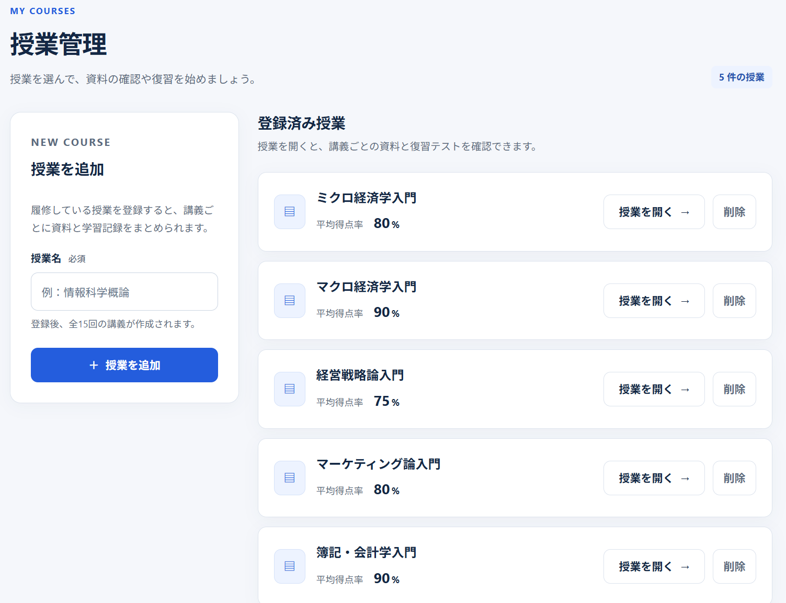
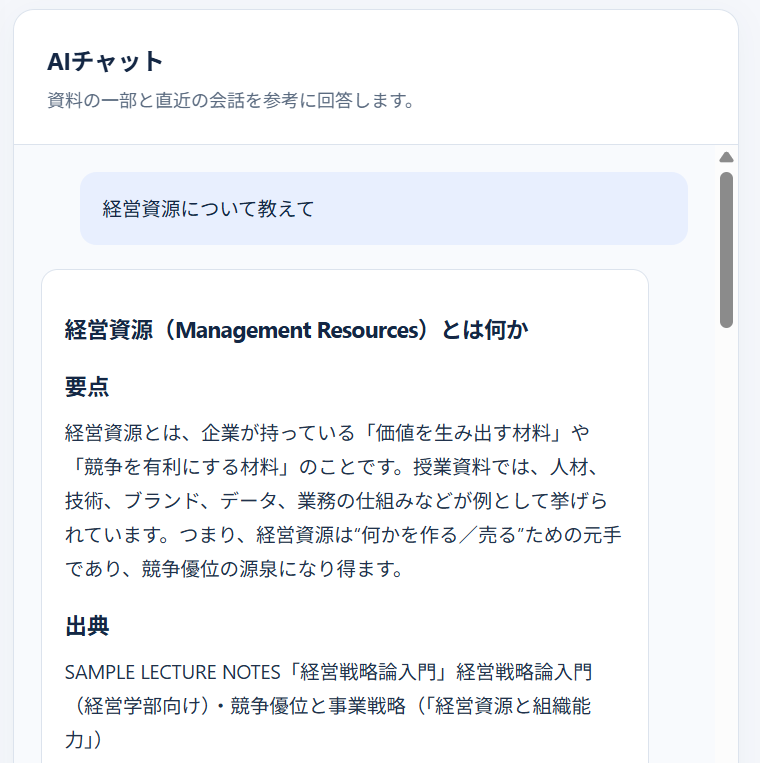
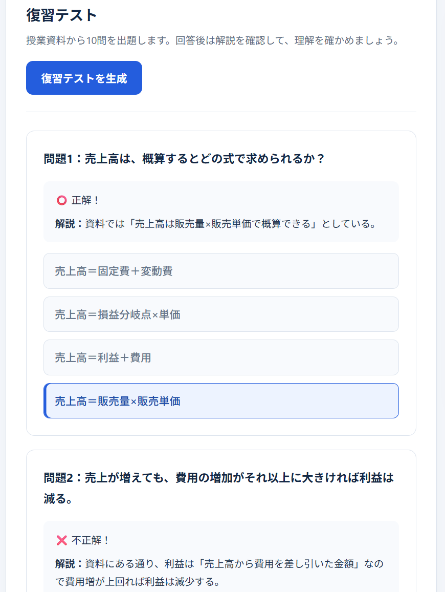
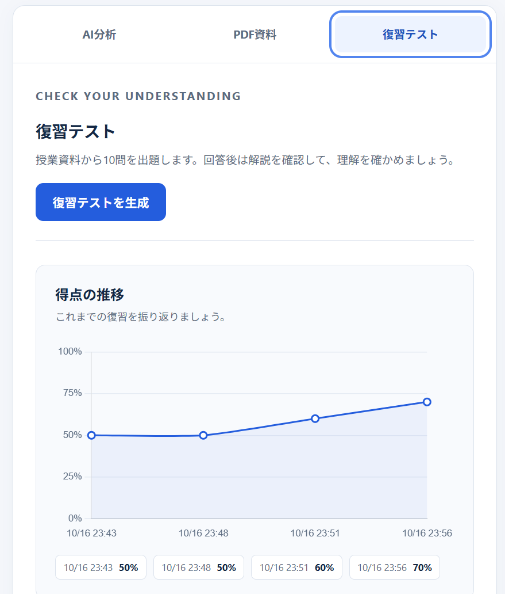

# 単位トルトル君 | tanitorutorukun

講義資料の整理から理解度の確認までを支援する、大学生向けのAI学習支援Webアプリです。PDFの講義資料をもとに、AIによる要約・重要語句の抽出・質問への回答・復習テストの生成を行います。

**[公開サイトを開く](https://studyhub-ai-l46g.onrender.com/)**

## 開発の目的

大学の講義では、多くの資料から重要な内容を整理し、理解したことを確かめながら復習する必要があります。

単位トルトル君は、資料を読むだけで終わらず、要点の把握から疑問の解消、復習テストまでを一つの流れで行えるようにすることを目指しています。AIを活用して学習の準備にかかる負担を減らし、理解を深める時間につなげるために開発しています。

### 開発のきっかけ

【実際に講義や試験勉強で困った経験と、このアプリを作ろうと思った理由を2〜3文で記載】

## 主な機能

| 機能 | 内容 |
|---|---|
| 授業・講義の管理 | 授業ごと、講義回ごとに資料と学習記録を整理 |
| PDFアップロード | 講義資料をアップロードして学習に利用 |
| AI要約・重要語句の抽出 | 資料の要点と復習で押さえたいキーワードを整理 |
| AIチャット | 資料の一部と直近の会話を参考に質問へ回答 |
| 復習テスト | 資料に基づく問題を生成し、回答後に正誤と解説を表示 |
| 得点の推移 | 過去の復習テストの得点をグラフで確認 |

## 画面紹介

### 授業ごとに資料と学習記録を整理

授業を登録し、講義ごとの資料や復習テストを管理できます。授業一覧では平均得点率を確認できます。

### AIチャットで疑問を確認

講義資料について質問し、説明を確認できます。画面例では、経営資源についての質問に対して要点と出典が表示されています。

### 復習テストで理解度を確認

講義資料に基づく問題に取り組み、回答後に正誤と解説を確認できます。

### 得点の推移を振り返る

過去の復習テストの得点をグラフで表示し、学習の振り返りを支援します。

## 利用の流れ

1. 授業を登録し、対象の講義にPDF資料をアップロードする
2. AIによる要約と重要語句を確認する
3. 不明な点をAIチャットで質問する
4. 復習テストに取り組み、正誤と解説を確認する
5. 得点の推移を振り返り、理解が不十分な部分を元の資料で確認する

AIの生成内容には誤りが含まれる場合があるため、講義資料と照らし合わせながら利用することを想定しています。

## 使用技術

| 分野 | 技術 |
|---|---|
| バックエンド | Python / Flask |
| フロントエンド | HTML / CSS / JavaScript |
| AI機能 | OpenAI API |
| アプリケーションの公開 | Render |

## 開発体制

個人開発
codex使用

## 工夫した点

### 学習の流れをつなぐ構成

要約・重要語句・AIチャット・復習テストを組み合わせ、内容の把握から疑問の解消、理解度の確認までを行える構成にしています。

### 学習記録の可視化

授業ごとの平均得点率や復習テストの得点推移を表示し、学習状況を振り返れるようにしています。

## 今後の課題

- **AIによる要約・問題の品質改善**：講義資料の内容をより正確に反映し、要点を捉えた要約と、理解度の確認に役立つ問題の生成を目指します。
- **使いやすさの改善**：資料の登録から復習まで、迷わず操作できる画面や導線に改善していきます。
- **利用者の意見をもとにした機能の見直し**：実際の学習場面での意見を取り入れ、必要な機能や改善の優先順位を検討します。

## ライセンス

本リポジトリのソースコードは、[MIT License](LICENSE) のもとで公開しています。

